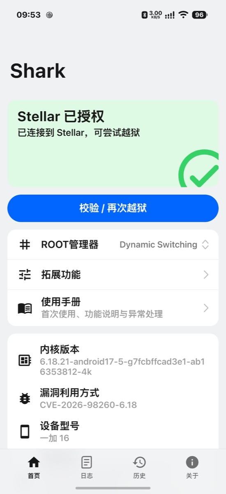
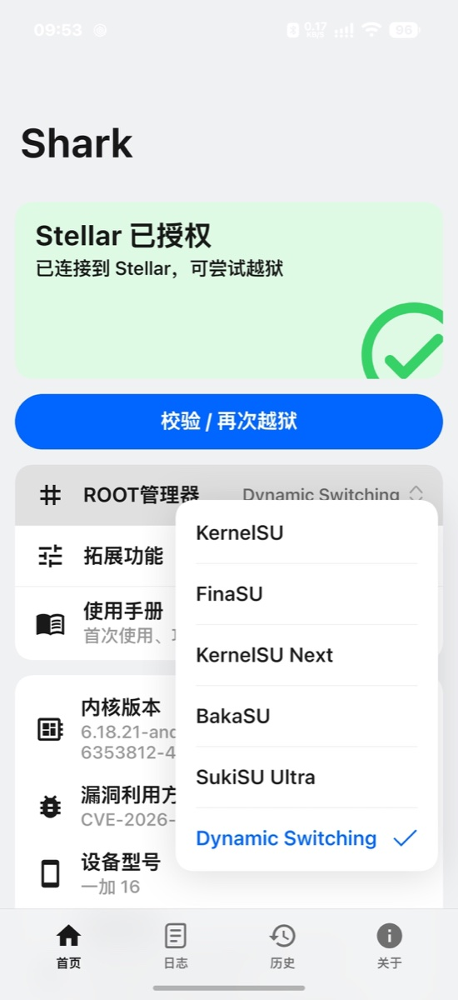
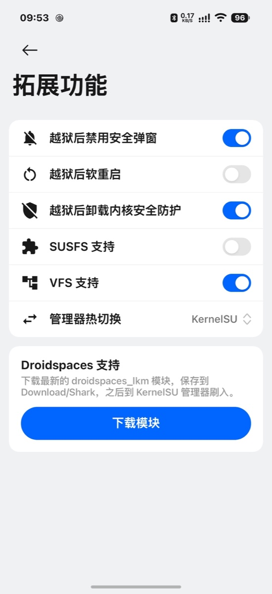
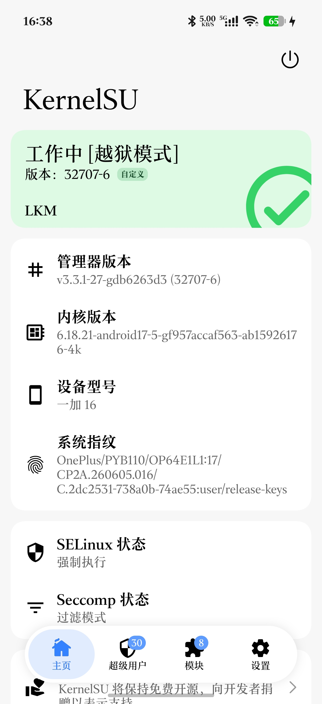
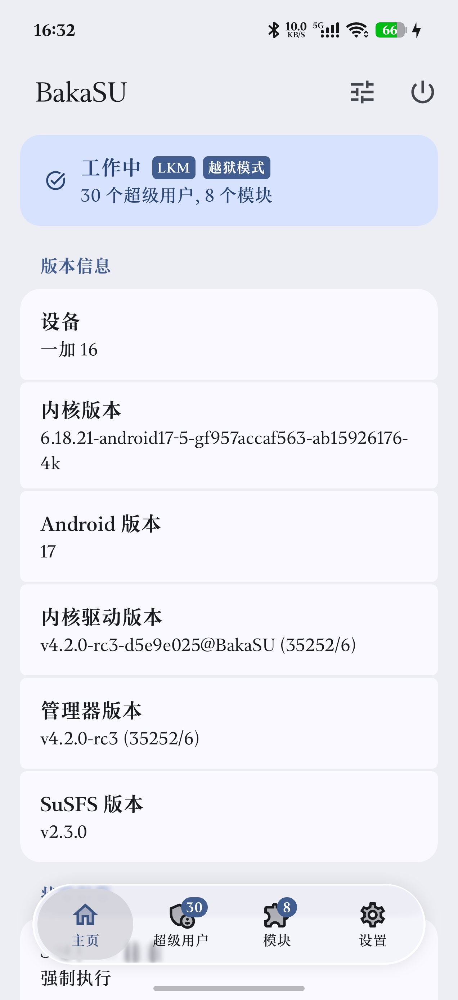
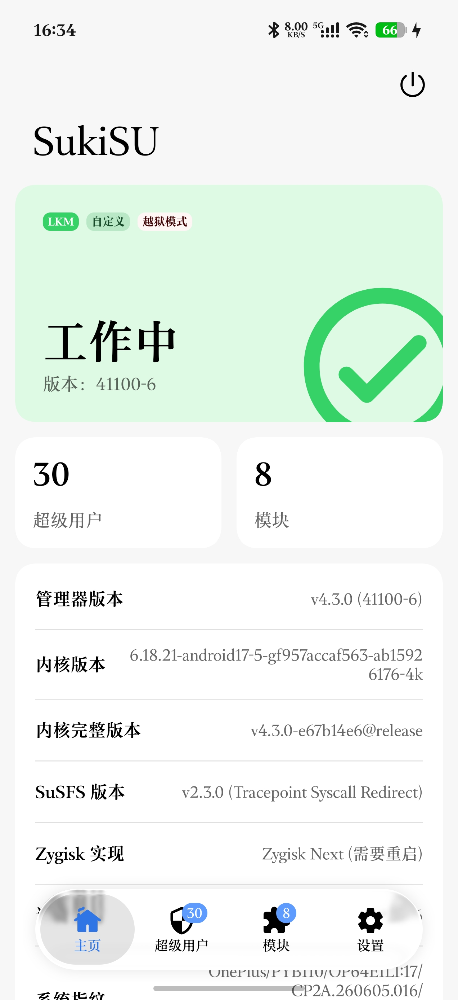

<h1 align="center"> Shark</h1>

<p align="center"><b>One-tap temporary root and manager switching for a wide range of Android devices</b></p>

<p align="center"><sub>Full-source tree — official source lives at Gitee (puci1/Shark), GitHub release channel: <a href="https://github.com/Yunnijian/Shark-Releases">Yunnijian/Shark-Releases</a>. Port work for the Infinix GT 30 Pro (X6873 / MT6897): see <code>ports/x6873/</code>. Licensing & attribution: <a href="LICENSE">LICENSE</a>, <a href="NOTICE">NOTICE</a>.</sub></p>

<p align="center">
  <a href="LICENSE"></a>
  
  
  
  
</p>

Shark supports OnePlus, OPPO, Realme, iQOO and more — no bootloader unlock needed, and all
you need to get started is adb shell. The app drives the on-device exploit through Stellar
or Shizuku, and once it has temporary kernel privileges it loads the LKM for the selected
manager, ending up with a root environment from KernelSU, KernelSU-Next, BakaSU,
SukiSU Ultra or FinaSU.

## Screenshots

<table align="center">
  <tr>
    <td align="center"><br><sub><b>Home</b></sub></td>
    <td align="center"><br><sub><b>ROOT manager</b></sub></td>
    <td align="center"><br><sub><b>Extras</b></sub></td>
  </tr>
  <tr>
    <td align="center"><br><sub><b>KernelSU</b></sub></td>
    <td align="center"><br><sub><b>BakaSU</b></sub></td>
    <td align="center"><br><sub><b>SukiSU Ultra</b></sub></td>
  </tr>
</table>

## Supported devices

| Device | OS | Full kernel version |
| --- | --- | --- |
| OnePlus 16 (PYB110) | ColorOS 17 | `6.18.21-android17-5-gf957accaf563-ab15926176-4k`<br>`6.18.21-android17-5-g7fcbffcad3e1-ab16353812-4k` |
| OnePlus 15 (PLK110) | ColorOS 17 | `6.12.69-android16-6-g242e1a07f878-ab15865446-4k`<br>`6.12.69-android16-6-g5fd39602326e-ab16372235-4k` |
| OnePlus 15T (PLZ110) | ColorOS 17 | `6.12.69-android16-6-g242e1a07f878-ab15865446-4k`<br>`6.12.69-android16-6-g5fd39602326e-ab16372235-4k` |
| OnePlus Ace7 Pro (PMS110) | ColorOS 17 | `6.12.69-android16-6-g242e1a07f878-ab15865446-4k`<br>`6.12.69-android16-6-g5fd39602326e-ab16372235-4k` |
| OnePlus Ace7 (PYF110) | ColorOS 17 | `6.12.69-android16-6-g242e1a07f878-ab15865446-4k`<br>`6.12.69-android16-6-g5fd39602326e-ab16372235-4k` |
| OnePlus Ace6T (PLR110) | ColorOS 17 | `6.12.69-android16-6-g242e1a07f878-ab15865446-4k`<br>`6.12.69-android16-6-g5fd39602326e-ab16372235-4k`<br>`6.12.38-android16-5-g844001fb8721-ab14552068-4k` |
| OnePlus Ace6 Ultra (PMB110) | ColorOS 17 | `6.12.69-android16-6-g242e1a07f878-ab15865446-4k`<br>`6.12.69-android16-6-g5fd39602326e-ab16372235-4k` |
| OnePlus Ace6 (PLQ110) | ColorOS 17 | `6.6.118-android15-8-g9bc34d5b0c79-abogki537459655-4k` |
| OnePlus Ace5 Pro (PKR110) | ColorOS 17 | `6.6.118-android15-8-g9bc34d5b0c79-abogki537459655-4k` |
| OnePlus Pad3 Pro (OPD2513) | ColorOS 16/17 | `6.12.69-android16-6-g242e1a07f878-ab15865446-4k`<br>`6.12.69-android16-6-g5fd39602326e-ab16372235-4k`<br>`6.12.58-android16-6-g7704a1ae279b-ab15213644-4k` |
| OnePlus Pad2 Pro (OPD2413) | ColorOS 17 | `6.6.118-android15-8-gc4127a25dcf3-ab15863337-4k` |
| OPPO Find X9 Ultra (PMA110) | ColorOS 17 | `6.12.69-android16-6-g242e1a07f878-ab15865446-4k`<br>`6.12.69-android16-6-g5fd39602326e-ab16372235-4k` |
| OPPO Find X9 Pro (PLG110) | ColorOS 17 | `6.12.69-android16-6-g242e1a07f878-ab15865446-4k`<br>`6.12.69-android16-6-g5fd39602326e-ab16372235-4k` |
| OPPO Find X9 (PLJ110) | ColorOS 17 | `6.12.69-android16-6-g242e1a07f878-ab15865446-4k`<br>`6.12.69-android16-6-g5fd39602326e-ab16372235-4k` |
| OPPO Find X9s Pro (PME110EX) | ColorOS 17 | `6.12.69-android16-6-g242e1a07f878-ab15865446-4k`<br>`6.12.69-android16-6-g5fd39602326e-ab16372235-4k` |
| OPPO Find X10 (PMX110) | ColorOS 17 | `6.12.69-android16-6-g242e1a07f878-ab15865446-4k`<br>`6.12.69-android16-6-g5fd39602326e-ab16372235-4k` |
| OPPO Find X8 Ultra (PKJ110) | ColorOS 17 | `6.6.118-android15-8-g9bc34d5b0c79-abogki537459655-4k` |
| OPPO Find N5 (PKH110) | ColorOS 17 | `6.6.118-android15-8-gc4127a25dcf3-ab15863337-4k` |
| OPPO Pad Mini (OPD2512) | ColorOS 16/17 | `6.12.69-android16-6-g242e1a07f878-ab15865446-4k`<br>`6.12.69-android16-6-g5fd39602326e-ab16372235-4k`<br>`6.12.58-android16-6-g7704a1ae279b-ab15213644-4k` |
| OPPO Pad 5 Pro (OPD2511) | ColorOS 17 | `6.12.69-android16-6-g242e1a07f878-ab15865446-4k`<br>`6.12.69-android16-6-g5fd39602326e-ab16372235-4k` |
| OPPO Pad4 Pro (OPD2409) | ColorOS 17 | `6.6.118-android15-8-gc4127a25dcf3-ab15863337-4k` |
| Realme GT8 Pro (RMX5200) | ColorOS 17 | `6.12.69-android16-6-g242e1a07f878-ab15865446-4k`<br>`6.12.69-android16-6-g5fd39602326e-ab16372235-4k` |
| Realme GT8 (RMX6699) | ColorOS 17 | `6.6.118-android15-8-g9bc34d5b0c79-abogki537459655-4k` |
| Realme GT7 Pro (RMX5010) | ColorOS 17 | `6.6.118-android15-8-g9bc34d5b0c79-abogki537459655-4k` |
| Realme Neo8 (RMX8899) | ColorOS 16/17 | `6.12.38-android16-5-g844001fb8721-ab14552068-4k`<br>`6.12.69-android16-6-g242e1a07f878-ab15865446-4k`<br>`6.12.69-android16-6-g5fd39602326e-ab16372235-4k` |
| iQOO 15 (V2505A) | OriginOS 6/7 | `6.12.23-android16-5-g41f4cb1fa7c7-abogki465038634-4k`<br>`6.12.58-android16-6-g0a092cc0037a-abogki521987229-4k`<br>`6.12.58-android16-6-gdd6fd5c98918-abogki543627742-4k`<br>`6.12.58-android16-6-g690108013dcc-abogki576129896-4k` |
| iQOO 15 Ultra | OriginOS 7 | `6.12.58-android16-6-gdd6fd5c98918-abogki543627742-4k` |
| iQOO Pad Pro 8.8-inch | OriginOS 7 | `6.12.58-android16-6-gdd6fd5c98918-abogki543627742-4k` |
| iQOO Pad6 Pro | OriginOS 7 | `6.12.58-android16-6-gdd6fd5c98918-abogki543627742-4k` |
| vivo X200 Ultra (PD2454) | OriginOS 7 | `6.6.127-android15-8-gd489d4ad2a70-abogki567717946-4k` |
| Infinix GT 30 Pro (X6873) | XOS 16 | `6.1.157-android14-11-ga8b0b542991e-ab15601211` (ported — constants final from the stock boot.img static parse, zero drift between 16.3.0.150SP09 and 16.3.0.160SP02; see `ports/x6873`) |

The 6.12.58 OS7 builds (`gdd6fd5c98918` / `g690108013dcc`) and 6.6.127 use the vivo
`hooks_defend` load-gate bypass. OS7 does not offer SUSFS yet (several gate whitelist
entries are still missing) but keeps manager hot switching; 6.6.127 has no matching
6.6 guard KO / universal loader, so neither SUSFS nor hot switching is offered there.

## Supported managers

KernelSU, KernelSU-Next, BakaSU, SukiSU Ultra and FinaSU.

Manager APKs are not distributed with Shark. Normal mode uses the `ksud` inside the
installed manager APK directly — so **install the one you want to use first**.

## What it can do

- **One-tap temporary root**: no manual exploit picking — the app auto-matches
  `uname -r` against the 6.18.21 / 6.12.69 / 6.12.38 / 6.12.58 / 6.12.23 / 6.6.118 /
  6.6.127 / 6.1.157 chains. One tap of **One-tap jailbreak** finishes the privilege
  escalation, `ksud late-load`, module install and manager launch; the temporary root
  disappears after a reboot — just run it again on the next boot.
- **Five managers to choose from**: the ROOT manager dropdown selects KernelSU,
  KernelSU-Next, BakaSU, SukiSU Ultra or FinaSU directly. The app is not tied to any
  one of them; manager APKs are user-installed, and normal mode uses that APK's own
  ksud and LKM.
- **Manager hot switching** (6.18 and 6.12): run once from a clean boot with
  `Dynamic Switching` selected to load the universal KSU LKM (initially KernelSU),
  then pick the target manager in Extras → **Manager hot switch**. The switch
  synchronizes version, features, the private ioctl and the primary manager, and
  reopens the target manager — no reboot, no re-jailbreak.
- **Extras**: VFS provider for 6.18; SUSFS for 6.12 / V2505A; plus the anti-root popup
  suppressor, post-jailbreak soft reboot and kernel-security unload switches. Enable
  as needed — a single item failing never affects the root you already have.
- **Logs and history**: the run log streams live; every jailbreak saves a full log to
  the History page where you can view, delete or swipe-to-export it for debugging or
  archiving.
- **In-app updates**: checks Gitee Releases on start and falls back to GitHub; a new
  version downloads in-app and is handed to the system installer after SHA-256 and
  APK-signature verification.
- **Droidspaces support** (6.18): one tap fetches the latest `droidspaces_lkm` module
  into `Download/Shark/`; flash it afterwards from the KernelSU manager. The module is
  not bundled with the app.

## Two ways to get root

### Normal mode

Pick a manager in ROOT manager; the app uses that manager APK's own `ksud` to load its
LKM. That is the manager's native root environment.

Switching managers in normal mode still needs a reboot.

### Extended mode

Select `Dynamic Switching` in ROOT manager. The app loads the universal KSU LKM with
the bundled `libksud_universal.so`; the initial manager is KernelSU.

After loading, Extras gains **Manager hot switch**: open the dropdown, pick the target
manager and the app switches and reopens it automatically. The switch only changes the
manager profile inside the kernel — no module unload, no reboot.

The universal KO shares its name and hooks with stock KSU, so the first load must
happen from a clean boot with no KSU loaded; it cannot hot-replace an already-loaded
`kernelsu`.

## Usage

1. Install the manager APK you want to use. For Dynamic Switching, install all five.
2. Start Stellar or Shizuku and grant Shark permission.
3. Pick a normal manager or `Dynamic Switching` in the ROOT manager dropdown.
4. Enable the extras you want.
5. Tap **One-tap jailbreak** and wait for `DONE` in the log.
6. Normal mode: open the manager and grant root; Dynamic Switching: pick the target
   manager in Extras — the app switches and opens it automatically.

## Project layout

Shark consists of the Android app, the on-device exploit runners and optional kernel
modules.

```text
Shark/
├── app/                         Android app (Gradle project)
│   ├── app/src/main/java/com/shark/kty/
│   │   ├── MainActivity.kt      four tabs, flow control, manager & extras state
│   │   ├── UpdateChecker.kt     Gitee / GitHub update checks
│   │   ├── HistoryStore.kt      log persistence and history
│   │   └── DroidspacesModule.kt Droidspaces module download
│   ├── app/src/main/jniLibs/arm64-v8a/
│   │   ├── libk61821.so         6.18.21 runner
│   │   ├── libk61269.so         6.12.69 runner
│   │   ├── libk61238.so         6.12.38 runner
│   │   ├── libk61258.so         6.12.58 runner
│   │   ├── libk61223.so         6.12.23 runner
│   │   ├── libk66118.so         6.6.118 runner
│   │   ├── libk66127.so         6.6.127 runner
│   │   ├── libk61157.so         6.1.157 (Infinix GT 30 Pro) runner
│   │   ├── libksud_universal.so dual-KMI universal loader
│   │   ├── libsusfs_guard_lkm.so
│   │   ├── libsusfs_guard_lkm_612.so
│   │   └── libhybridmount.so
│   ├── app/src/main/assets/     manual.md, licenses, donation QR codes
│   └── gradle/, keystore/
├── exploit/
│   ├── rust-k61821/             6.18.21 Rust runner
│   ├── rust-kplant/             6.12 / 6.6 / 6.1 Rust runner (feature picks the K source)
│   └── src/                     plant_core.inc + K<version>_plant.c (one per kernel)
├── lkm/
│   ├── susfs4ksu-lkm/           SUSFS guard sources
│   ├── hybridmount/             VFS provider sources
│   └── susfs-tools/             SUSFS rule tools
├── docs/screenshots/            README screenshots
├── ports/v2505a/                V2505A notes and verification record
├── ports/coloros-61269/         6.12.69 dual-OTA build notes and recovery tools
├── ports/pkj110-66118/          PKJ110 6.6.118 notes and verification record
├── ports/pd2454-66127/          vivo 6.6.127 notes and verification record
├── ports/x6873/                 X6873 port record and derivation tools
├── third_party/                 third-party licenses and materials
├── NOTICE / LICENSE
└── README.md
```

**Module breakdown**

- `app/`: Kotlin/Compose UI, Shizuku/Stellar bridge, exploit chain selection, extras
  switches, logs and in-app updates.
- `exploit/`: the Rust single-entry runners and C plants — privilege escalation, fake
  cred, `ksud late-load` and the finishing steps.
- `lkm/`: sources and build scripts for the SUSFS guard and the Hybrid Mount VFS
  provider.
- `ports/v2505a/`: V2505A branch notes, constants and verification record.
- `ports/pd2454-66127/`: vivo 6.6.127 branch notes, constants and OTA extraction tools.
- `ports/x6873/`: Infinix GT 30 Pro (6.1.157) port record — final constants from the
  stock boot.img static parse, plus the on-device derivation tools.
- `third_party/`: full third-party license texts and reference materials.

**Tech stack**

- App: Kotlin, Jetpack Compose, COUI-Kit, Shizuku / Stellar API.
- On-device: Rust + C, Android NDK arm64.
- Kernel side: C / GPL-2.0 LKMs; the universal KSU KO lives in a separate project,
  [KSU-Universal](https://github.com/Yunnijian/KSU-Universal).
- Build: Gradle Kotlin DSL, Cargo, Android SDK/NDK, Docker DDK.

## Building it yourself

App:

```bash
cd app
./gradlew :app:assembleRelease
```

On-device runners (one `libk<version>.so` per kernel, installed into jniLibs
automatically):

```bash
export ANDROID_NDK_HOME=/path/to/ndk
./exploit/build-all.sh
```

You can also build a single chain:

```bash
cd exploit/rust-kplant
cargo build --release --target aarch64-linux-android \
    --no-default-features --features k66118
```

Available features: `k61269`, `k61238`, `k61258`, `k61223`, `k66118`, `k66127`,
`k61157`; 6.18.21 builds separately from `rust-k61821`.

The universal KO and the dual-KMI loader are built in
[KSU-Universal](https://github.com/Yunnijian/KSU-Universal); Shark only bundles the
prebuilt `libksud_universal.so`.

## Notes

- Dynamic Switching needs one clean boot for the first load; switching afterwards
  needs no reboot.
- Normal mode requires the manager APK to be installed first — ksud is not bundled
  with Shark.
- KPM is not enabled yet.
- CVE-2026-98260 is a racing UAF: any single run can panic or reboot the kernel.
- The 98260 engine is only proven on 6.18/6.12/6.6 GKI kernels; on 6.1.157 (X6873)
  the same race applies in source but the reclaim behavior can only be confirmed by
  the on-device run — see the engine caveat in `ports/x6873/README.md`.
- Use it only on devices you own, at your own risk.

## Sources and licensing

- Shark's own code is GPL-3.0, see `LICENSE`; third-party components see `NOTICE`.
- The universal KSU LKM is based on SukiSU Ultra, GPL-3.0.
- SUSFS guard and Hybrid Mount are GPL-2.0.
- The CVE-2026-98260 design references AzirX1337's public port (MIT).
- The UI uses COUI-Kit (MPL-2.0); remote execution uses the Shizuku API (Apache-2.0).

## Releases

- GitHub (docs + APK): https://github.com/Yunnijian/Shark-Releases — v2.4.1
- GitHub: https://github.com/Yunnijian/Shark/releases/tag/v2.0
- Gitee: https://gitee.com/puci1/Shark/releases/tag/v2.0
- App: v2.0 (90)
- APK SHA-256: `29dabba7fe144593a057715b30ccf0f1aaf5295b12d2883381f62fa6b10d3e94`

Universal kernel releases:

- https://github.com/Yunnijian/KSU-Universal/releases/tag/v1.1.0
- `ksu_universal-android16-6.12.ko`
- `ksu_universal-android17-6.18.ko`
- `ksud_universal`
